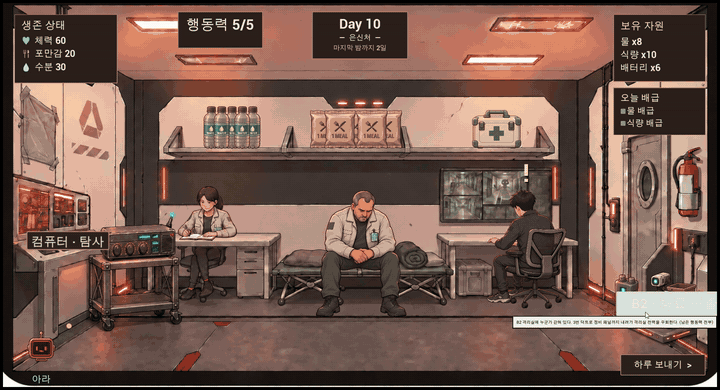
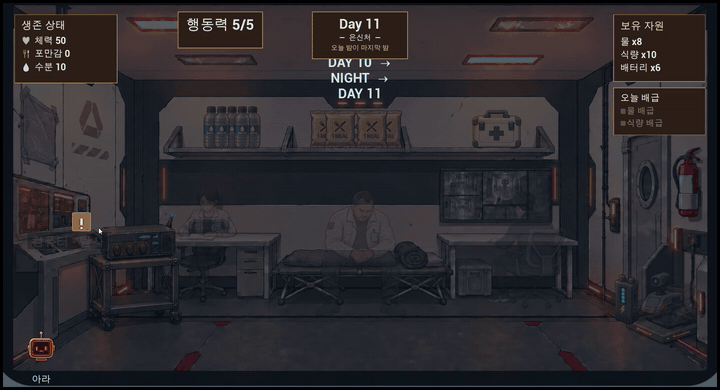
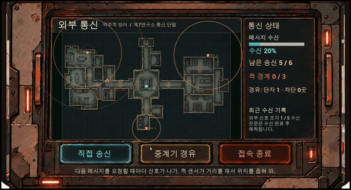
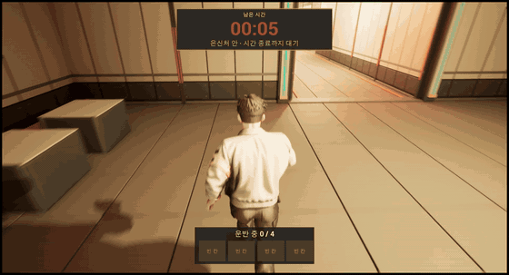
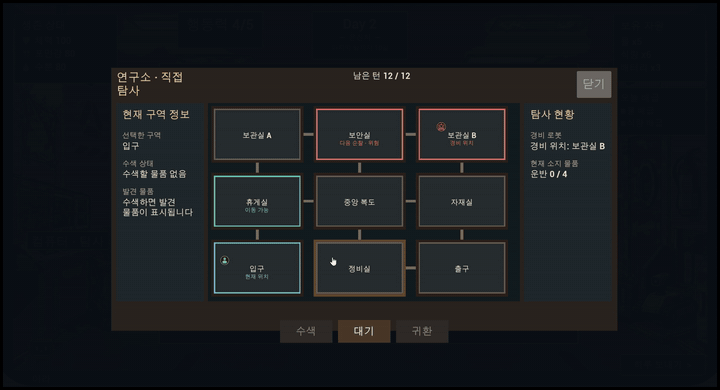

# SixtySeconds — 제7연구소

> 60초 안에 물자와 동료를 챙겨 대피실로 들어간 뒤,
> 연구소 AI '아라'가 동료를 하나씩 안드로이드로 바꿔치기하는 12일을 버티는 생존 게임.

[](https://youtu.be/1uv9EhBvPs4)

**▶ 플레이 영상 1분 45초: https://youtu.be/1uv9EhBvPs4**

| 항목 | 내용 |
|---|---|
| 엔진 | Unreal Engine 5.7 · C++ (UI·연출 연결은 Blueprint/WBP) |
| 장르 | 3D 60초 스크램블 + 2D 턴제 생존 · 추리 |
| 개발 | 1인 · 2026.09 – 2026.10 |
| 규모 | C++ 약 2.6만 줄 · 자동화 테스트 68개 · 에디터 Python 자동화 스크립트 |
| 원칙 | 미니게임마다 다른 알고리즘 · 규칙은 화면 없는 클래스에 두고 테스트로 검증 |

---

## 게임 흐름

```
[60초 스크램블] 3D 연구소에서 물자·동료 수집 → 격벽 폐쇄
      ↓
[낮] 배급 · 로봇 파견 · 직접 탐사 · 무전(역추적/해독) · 검사 · B2 구출   (행동력 5)
      ↓
[밤] 동료가 연구소를 조사 · 아라가 엿듣고 의심을 갱신 · 밤 사건
      ↓
[아침] 보고 대화 → 단서 → … → 바꿔치기 → 구출 → 숨은 진실 → 아라와 대면 → 서버실 엔딩 3종
```

---

## 핵심 시스템

### 1. B2 전력 우회 퍼즐 — 항상 풀리고, 예산 안에서 풀리게


- **생성:** 이음선을 섞은 뒤 유니온-파인드로 서로 다른 묶음만 잇는 **무작위 크루스칼** → 신장 트리가 곧 정답 배선이라 항상 풀림
- **예산 보장:** DFS로 정답 경로를 찾아 필요한 회전 수를 세고, 회전 예산의 60% 이하가 될 때까지 다시 섞음
- **판정:** 타일은 4비트(북동남서), 회전은 `((m << 1) | (m >> 3)) & 15`, 전력은 맞물린 이음만 유니온-파인드로 합쳐 판정
- **연출:** 바꿔치기된 사람은 구하기 전까지 "신원 미상". 성공하는 순간 정체가 드러남
- 코드: [`SSPowerGrid.cpp`](Source/SixtySeconds/Private/Rescue/SSPowerGrid.cpp) · [`SSRescueSession.cpp`](Source/SixtySeconds/Private/Rescue/SSRescueSession.cpp)

### 2. 아라의 의심 — 베이즈 로그 오즈


- 동료마다 "진실에 다가갔을 확률"을 로그 오즈로 저장 → 관찰마다 가능도 비율의 로그를 더하기만 함
- 엿들은 단서 대화 ×8, 그냥 대화 ×2, 밤에 들킴, 조용한 밤, 거절, 패널 경보가 각각 증거
- 매일 처음 믿음 쪽으로 조금씩 잊음 · 표적은 오를 때 0.7 / 풀릴 때 0.4 (히스테리시스)
- **진행 보장:** 5일째까지 표적이 없으면 위협도 최상위를 표적으로, 붙잡히면 남은 동료가 구출 길을 알려 줌, 진실을 모으면 그날 밤 아라와 대면
- 코드: [`SSAraDirector.cpp`](Source/SixtySeconds/Private/Ara/SSAraDirector.cpp) · [`SSEndingState.cpp`](Source/SixtySeconds/Private/Ending/SSEndingState.cpp)

### 3. 외부 통신 — 역추적 방어와 감청 해독


- **역추적:** 박스-뮬러 잡음 섞인 거리 측정 → **가우스-뉴턴**으로 위치 추정 → 공분산의 고윳값으로 **오차 타원**. 화면의 타원이 곧 들킴 판정 영역
- 정규화 카이제곱으로 측정끼리 안 맞음을 감지 (미끼 신호)
- **해독:** 비즈네르 다이얼 3개(카이제곱 신호 세기) / 치환 암호 + 글자쌍 확률표 힐 클라이밍 자동 해독기
- 코드: [`SSSignalFinder.cpp`](Source/SixtySeconds/Private/Trace/SSSignalFinder.cpp) · [`SSTraceSession.cpp`](Source/SixtySeconds/Private/Trace/SSTraceSession.cpp) · [`SSCipher.cpp`](Source/SixtySeconds/Private/Decode/SSCipher.cpp)

### 4. 스크램블과 직접 탐사
 

- **아이템 배치:** 스폰 자리 + 배치 규칙 DataAsset. 방마다 최소 1개, 비율 추첨. 계산은 월드 없이 테스트 (같은 시드 → 같은 배치, 200시드 검증)
- **격벽 폐쇄:** 60초 종료 순간 결과 확정(한 번만) → 문 닫힘 → 경비 등장. 맵과 코드 분리(태그·에디터 값)
- **직접 탐사:** 턴제 잠입. 경비가 다음 위치를 예고. BFS로 출구 도달·통로 연결을 Data Validation에서 검출
- 코드: [`SSItemSpawnTypes.cpp`](Source/SixtySeconds/Private/Item/SSItemSpawnTypes.cpp) · [`SSLabLockdownDirector.cpp`](Source/SixtySeconds/Private/Phase/SSLabLockdownDirector.cpp) · [`SSExplorationSession.cpp`](Source/SixtySeconds/Private/Exploration/SSExplorationSession.cpp)

### 5. 데이터 기반 사건·대사·엔딩
- 사건·선택지·효과 CSV 3장 → DataTable → 카탈로그. 조건, 확률, 후속 사건 예약, 엔딩까지 데이터
- 동료 대사·단서·아라 대사도 CSV. 문장 추가에 C++ 수정 없음
- 카탈로그 `Validate`로 끊긴 참조·잘못된 확률을 에디터에서 검출
- 코드: [`SSEventDirector.cpp`](Source/SixtySeconds/Private/Event/SSEventDirector.cpp) · 데이터: `Design/Events/*.csv`

---

## 구조

```
USSRunSubsystem (GameInstanceSubsystem) — 보관함 · 날짜 · 스탯 · 기록 · 동료 명단
 ├─ USSCompanionState   밤 조사 · 보고 · 안드로이드
 ├─ USSAraDirector      의심 · 표적 · 바꿔치기
 ├─ USSCommsState       무전 수신 · 해독 대기함
 ├─ USSRescueState      B2 구출 열림 조건 · 결과
 ├─ USSEndingState      숨은 진실 · 엔딩
 └─ USSExpeditionState  로봇 파견 · 수리
```

- **상태 객체:** 처음 부를 때 `NewObject`, 부모는 `GetOuter()`로 되찾음. 서로 모르고 RunSubsystem의 공개 함수로만 부탁
- **세 층 분리:** 규칙(순수 계산: `FSSPowerGrid`, `FSSSignalFinder`) / 세션(작업 한 번: `USSRescueSession`, `USSExplorationSession`) / 위젯(C++ 부모 + WBP `BindWidget`)
- 1,443줄이던 RunSubsystem을 965줄로 나눔. 리팩터링 전후 테스트로 동작이 같음을 확인

---

## 테스트와 자동화

- **자동화 테스트 68개** (`Source/SixtySeconds/Private/Tests/`, 16그룹)
  - 퍼즐 생성 200판 모양 검사 · 100판 예산 안 풀이 / 가중치 추첨 1000밤 분포 / 로그 오즈 갱신 / 역추적 수렴·타원 / 엔딩 분기·생존 인원·아라 대면 / 같은 시드 같은 배치
- **에디터 Python 원격 실행** (`Tools/`): CSV 임포트, WBP 기본값 설정, 밸런스 수치 일괄 수정, 테스트 실행
- **코드 규칙:** `.clang-format`, `.gitattributes`(CRLF), generated 파일 편집 차단 훅

---

## 트러블슈팅 (일부)

| 문제 | 원인 | 해결 |
|---|---|---|
| 동료가 매번 같은 곳만 조사 | 선호 점수 차이를 흔들림이 못 뒤집음. 테스트는 범위만 봐서 통과 | 가중치 추첨으로 교체 + 분포 테스트(1000밤 3곳 이상) |
| 진행 보장 테스트가 가끔 실패 | 밤 조사의 무작위 들킴으로 표적이 먼저 생김, 호출 순서 착오 | 영향력 0으로 결정적 확인, 실제 순서(밤 → 날짜 증가) 반영 |
| 아침 보고인데 지금 숫자가 나옴 | 위젯이 클릭 시점에 판단 | 밤이 끝날 때 RunSubsystem이 만들어 고정 |
| 구출 버튼이 갑자기 생김 (플레이 테스트) | "누군가 갇혔다"를 알려 주는 정보가 없음 | 버튼이 처음 뜰 때 기록 + 패널 "신원 미상" → 성공 시 정체 공개 |
| 진실을 다 알아도 나흘간 버티기만 함 (플레이 테스트) | 바꿔치기 후 이야기가 멈춤 | 진실 2개를 모은 밤 아라와 대면 → 다음 날 밤 서버실 |
| 물이 필요량의 절반만 들어옴 (플레이 테스트) | 하루 수분 -25, 탐사 보상 1개 | 필요량 vs 획득량 계산 → 수분 -20, 보상 2~3개 |

---

## 실행

- Unreal Engine 5.7, Visual Studio 2022
- `SixtySeconds.uproject` → Generate Visual Studio project files → 빌드 → `L_MainMenu`에서 플레이
- 디버그 명령: `SS.Day <N>` · `SS.Ara.Target <Id>` · `SS.Rescue.Setup` · `SS.Ending <Resolve|Dominion|Reversal>`
- 테스트: Session Frontend → Automation → `SS.` 그룹

> 현재 저장소에는 소스 코드만 올라가 있습니다. 실행에 필요한 콘텐츠(에셋)는 별도로 제공합니다.

---

## 문서

- 포트폴리오 PDF: `Portfolio/SixtySeconds_Portfolio.pdf`
- 개발일지·시스템별 설계 문서: 노션 (링크 추가 예정)
